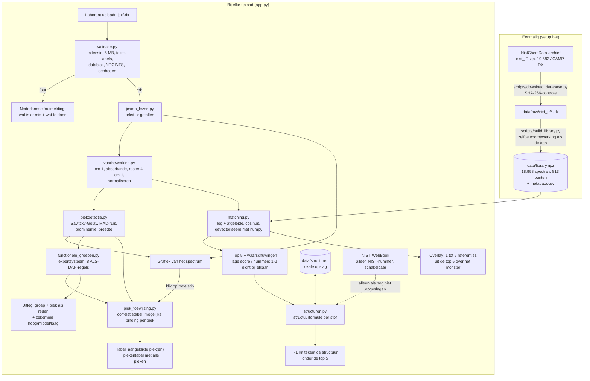

# Ontwerp van de IR-Stofherkenner

Hoort bij **LU2** (praktijkgerichte AI-oplossing ontwerpen en realiseren).

## 1. Doel en gebruiker

**Gebruiker:** een laborant of analist met een IR-spectrum van een onbekend of te controleren monster.
**Vraag:** "Welke stof is dit waarschijnlijk, en waarom denkt het systeem dat?"
**Antwoord van de app:** een top 5 met overeenkomstscores, een visuele vergelijking met het beste referentiespectrum,
en een uitleg in functionele groepen. De laborant beslist; de app ondersteunt.

## 2. Architectuur

`stofherkenner/analyse.py` knoopt de stappen aan elkaar, zodat `app.py` alleen nog toont en de tests precies dezelfde
keten kunnen draaien.

## 3. Ontwerpkeuzes

| Keuze | Alternatief | Waarom zo | Bewijs |
|---|---|---|---|
| **Geen machine learning**, maar klassieke/symbolische AI | Een neuraal netwerk of classifier trainen op de spectra | Een referentiebibliotheek doorzoeken past precies bij de vraag "welke stof is dit?". Het werkt voor elke stof met één referentiespectrum (veel stoffen hebben er maar één, dus te weinig voorbeelden om van te leren). Elke uitkomst is uit te leggen ("lijkt op dit spectrum", "piek bij 1742"). Een nieuwe stof toevoegen = een spectrum toevoegen, niet opnieuw trainen. | dit document; `docs/ai_logboek.md` |
| **Eigen JCAMP-DX-parser** (+ `jcamp` als controle in de tests) | `jcamp`, `spectrochempy`, `nmrglue` | Even nauwkeurig als `jcamp`, maar met strenge, Nederlandstalige foutafhandeling en zonder extra afhankelijkheid | `docs/onderzoek_jcamp_bibliotheken.md` |
| **Vast raster 550–3798 cm⁻¹, stap 4 cm⁻¹** | Elk spectrum op zijn eigen punten | Alle spectra worden vectoren van dezelfde lengte, dus vergelijken = matrixrekening. De randen bevatten in de NIST-data vaak storing. | `stofherkenner/voorbewerking.py` |
| **Middelen per rasterpunt** bij hoge resolutie | Alleen interpoleren | Hoge- en lage-resolutiemetingen van hetzelfde spectrum worden op het raster vrijwel gelijk | `tests/test_voorbewerking.py::test_hoge_en_lage_resolutie_geven_bijna_hetzelfde_raster` |
| **Duplicaten markeren** (cosinus ≥ 0,99 of zelfde QUANT-IR-reeks) | Alles meetellen | Anders meet de evaluatie het terugvinden van kopieën in plaats van het herkennen van stoffen | `scripts/build_library.py`, `docs/evaluatie.md` |
| **Cosinus op logaritme + afgeleide** | Kale absorbantie; Pearson; Euclidisch | Hoogste top-1; Pearson is even goed maar niet beter; cosinus is het eenvoudigst | `docs/evaluatie.md`, `docs/vergelijking_voorbewerking.md`, `docs/theorie_matching.md` |
| **Per stof het beste spectrum** in de top 5 | Top 5 spectra | Anders staat dezelfde stof meerdere keren in de lijst | `matching.zoek` |
| **Waarschuwingen** bij score < 65% of verschil nr. 1–2 < 5 procentpunt | Geen waarschuwing; alleen een score | De evaluatie laat zien dat ook foute antwoorden hoge scores krijgen | `docs/evaluatie.md` (scoreverdelingen) |
| **Functionele groepen als uitleg, niet als filter** | De top 5 filteren op gevonden groepen | De regels zijn niet foutloos (zie de regeltoets); als filter zouden ze goede antwoorden kunnen wegfilteren | `docs/controle_functionele_groepen.md` |
| **Gasfase-varianten in de regels** | Alleen studieboekwaarden (vloeistof) | ± 53% van de bibliotheek is gas; vrije O–H en zuur-monomeer zien er anders uit | `stofherkenner/functionele_groepen.py` |
| **"Eerlijke test"-schakelaar** in de app | — | De voorbeeldbestanden staan zelf in de bibliotheek en scoren dus 100%; met de schakelaar zie je het echte gedrag | `tests/test_app.py::test_eerlijke_test_geeft_geen_100_procent` |
| **Streamlit + Plotly** | Flask + JavaScript | Weinig code, interactieve en responsieve grafieken | `app.py` |
| **Opmaak in Windows 7-/IR-software-stijl** (wens student) | Standaard Streamlit-uiterlijk | Ziet er vertrouwd en professioneel uit voor laboranten. Alleen CSS met lokale lettertypen (niets van internet); geen nepmenu's die niets doen | `stijl.css`, `test_app.py::test_windows7_stijl_wordt_geladen` |
| **Overlay met 1–5 referenties** (wens student) | Eén referentie tegelijk | Vergelijken van de kandidaten in één oogopslag; standaard alleen nummer 1, zodat de grafiek rustig blijft | `test_app.py::test_overlay_kan_alle_top5_stoffen_tegelijk_tonen` |
| **Klik op een piek → mogelijke binding(en)** (wens student) | Alleen de piekentabel | Directe uitleg bij elke piek. Eerlijk "mogelijke" bindingen, want gebieden overlappen; regels die de piek gebruiken staan apart, zodat tabel en paneel elkaar niet tegenspreken | `stofherkenner/piek_toewijzing.py`, `tests/test_piek_toewijzing.py` |
| **Structuurformules bij de top 5** (wens student): ophalen bij NIST op NIST-nummer, lokaal bewaren, tekenen met RDKit | (a) PubChem op CAS-nummer; (b) alles vooraf downloaden; (c) geen structuren | Zelfde bron als de spectra (NIST) en elke stof in de bibliotheek heeft een NIST-nummer (niet elke stof een CAS-nummer). Alles vooraf downloaden zou bij de beleefde snelheid die NIST vraagt vele uren duren. Nadeel: de app gaat online; daarom een schakelaar en alleen het NIST-nummer wordt verstuurd (zie ethiek §6). Structuren worden pas aan het eind van de pagina geladen, zodat de rest niet hoeft te wachten | `stofherkenner/structuren.py`, `tests/test_structuren.py` |
| **Piekinformatie in IR-notatie** (wens student: "netjes en professioneel") | Gewone zinnen ("C=O: rek, keton") | Zoals in IR-literatuur: ν/δ/γ/ω, intensiteit sterk/middel/zwak, bandvorm scherp/breed; legenda eronder | `stofherkenner/piek_toewijzing.py` |
| **Spectrumgrafiek verandert niet na een klik** | Aangeklikte stip zelf geel kleuren in Python | Streamlit herkent een grafiek aan zijn inhoud; een andere figuur = "nieuwe" grafiek en dan is de klik vergeten (gevonden in de broncode van Streamlit). Plotly kleurt de stip daarom zelf in de browser | `stofherkenner/grafieken.py` |
| **Validatie vóór alles** | Pas fouten afvangen als het misgaat | Kapotte of kwaadaardige bestanden komen niet verder dan de controle; alle fouten worden een nette melding | `tests/test_validatie.py` (o.a. 400 willekeurig beschadigde bestanden) |

## 4. Wat bewust niet gebouwd is

- Geen opslag van geüploade spectra (privacy, eenvoud).
- Geen mengselanalyse (bijv. twee referenties optellen): buiten de scope van één dag.
- Geen eigen spectra toevoegen aan de bibliotheek via de app.
- Geen ondersteuning voor reflectie- of ATR-correctie.

Deze punten staan als mogelijke uitbreiding in `docs/planning_en_voortgang.md`.
